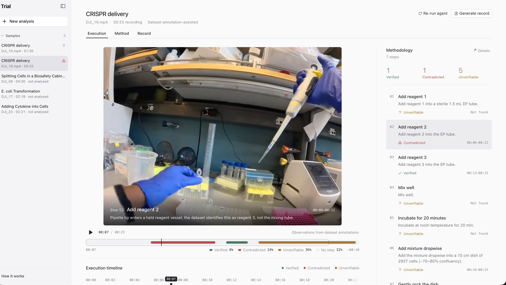
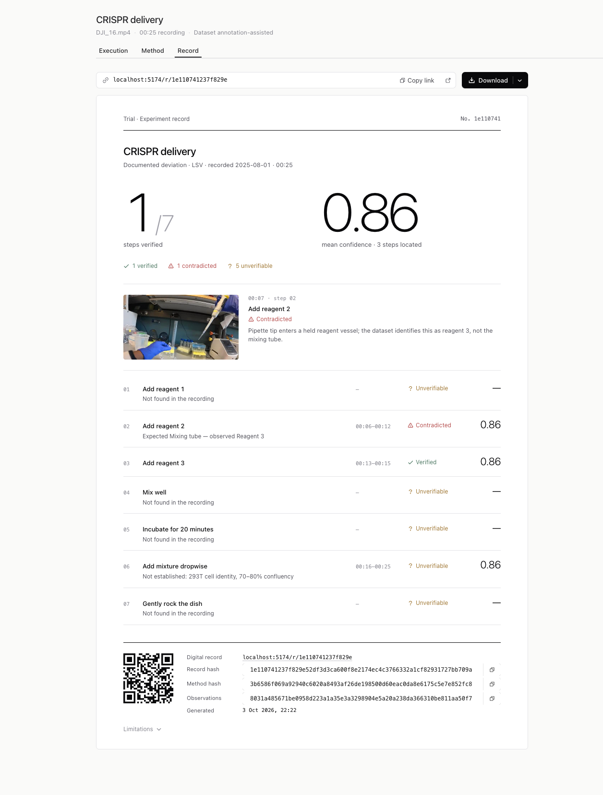

# Trial

Check a lab video against the method it was meant to follow.



Upload a paper or protocol and a video of the experiment. Claude reads the method, watches the video, and marks each step as **Verified**, **Contradicted** or **Unverifiable**, with timestamps you can jump to.

## Run it

Needs Node 22+ and an Anthropic API key.

```sh
npm ci
echo 'ANTHROPIC_API_KEY=sk-ant-…' > .dev.vars
npm run worker:dev   # API
npm run dev          # app at http://127.0.0.1:5174
```

No key? The app still opens, and the sample videos show saved results.

## How it works

1. Claude turns the paper into a list of steps.
2. An agent looks through the video, zooming in on the moments it needs.
3. Simple rules turn what it saw into a verdict for each step.

Finally it creates a report that is machine readable and traceable



There's a fuller walkthrough on the **How it works** page in the app.

Sample videos are from [LabSuperVision](https://huggingface.co/datasets/cong-lab/lsv) (CC BY-NC 4.0).
